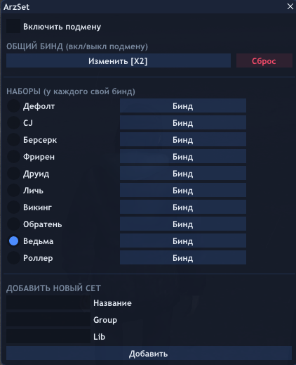

# ArzSet — Animation Set Manager

Менеджер анимаций для SA-MP (MoonLoader) с кастомным ImGui-интерфейсом, поддержкой биндов, комбинаций клавиш и сохранением конфигурации.

## Возможности

- 🎭 **Смена анимационных сетов** через ImGui-меню
- ⌨️ **Бинды на каждый сет** — комбинации клавиш (включая модификаторы и боковые кнопки мыши)
- 🔄 **Общий бинд** на быстрое включение/выключение подмены
- 💾 **Сохранение конфигурации** в `config/setanim.json`
- ⚡ **Защита от зависания** при загрузке битых анимаций (таймаут 5 сек)

## Скриншоты

## Установка

1. Установите [MoonLoader](https://www.blast.hk/threads/1753/) (версия 0.26+).
2. Установите библиотеки:
   - [`mimgui`](https://www.blast.hk/threads/103657/)
   - `encoding` (входит в стандартный набор MoonLoader)
   - `cjson` (входит в стандартный набор MoonLoader)
3. Скопируйте `speed.lua` в папку `MoonLoader/`.
4. Запустите игру, зайдите на сервер.
5. Введите `/arzset` или назначьте клавишу для открытия меню (в настройках скрипта).

## Использование

### Открытие меню
- По умолчанию — команда `/arzset`.

### Настройка биндов
1. Откройте меню.
2. Нажмите кнопку **"Назначить комбинацию"** у нужного сета.
3. Зажмите нужные клавиши (например, `LShift` + `F1`).
4. Нажмите **"Подтвердить"**.

### Управление камерой
Пока меню открыто, зажмите **ПКМ** — камера будет вращаться. Отпустите — управление вернётся к меню.

## Конфигурация

Все настройки сохраняются в `MoonLoader/config/setanim.json`:
- Список сетов (название, анимационная группа, библиотека).
- Бинды на каждый сет и общий бинд.
- Последний активный сет.
- Состояние подмены (вкл/выкл).

Если вы являетесь автором оригинального кода и хотите быть указаны в кредитах — свяжитесь со мной.

## Лицензия

Распространяется под лицензией **MIT**. См. файл [LICENSE](LICENSE).
